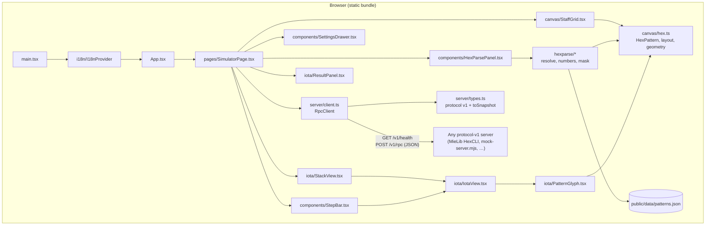

# Architecture

[中文](./ARCHITECTURE.zh-CN.md) · [README](./README.md) · [Protocol](./PROTOCOL.md)

## Goals

- **Pure frontend.** No bundled server, no Minecraft APIs, no build-time knowledge of MieLib.
- **Protocol-shaped, not vendor-shaped.** The client depends only on `docs/PROTOCOL.md`
  (`GET /v1/health`, `POST /v1/rpc`, the iota JSON schema). Any server speaking that dialect works.
- **Everything stateful lives in the browser.** Server URL, token, language, hexParse source and the
  drawn staff survive reloads via `localStorage`.

## Component diagram

## Data flow

### Casting

1. **Source selection.** `SimulatorPage` keeps hexParse `code` and the drawn `patterns` array.
   The *Run* mode toggle (`hexParse source` / `Drawn patterns`) decides which one is sent:
   - code mode: the textarea contents (falling back to the drawn staff if empty);
   - patterns mode: `patternsToCode(patterns)` emits `DIR_signature` tokens such as
     `NORTH_EAST_waaw`, which every hexParse-compatible server understands.
2. **Request.** `RpcClient.rpc({ cmd: "run", code })` POSTs to `${base}/v1/rpc` with
   `Authorization: Bearer <token>` when a token is configured. A correlation `id` is attached.
3. **Normalization.** `toSnapshot(response)` flattens the reply into a `CastSnapshot`, preferring
   `data.cast.stack` over `data.stack` (per protocol), defaulting missing arrays to `[]` and a
   missing stack to `null` (so "no stack reported" is distinguishable from "empty stack").
   `mergeStack(previous, next)` keeps the last known stack when a command (`reset`, `ping`,
   `step.abort`, …) does not report one.
4. **Rendering.** `StackView` reverses the bottom→top array so the top of stack is first and tagged.
   `IotaView` classifies each iota (`classifyIota`) and renders numbers, vectors, booleans, null,
   garbage, patterns, entities, collapsible lists or a generic chip with a type badge. Pattern
   iotas use `pattern.startDir` + `pattern.angles`; when those are absent, `patternFromIota` parses
   the `text` form (`NORTH_EAST waaw`).

### Drawing

1. `StaffGrid` maps pointer positions to axial hex coordinates (`screenToHex`).
2. Each stroke is a `HexPattern` (start direction + angle letters). `tryAppendDir` rejects illegal
   moves (backtracking onto an existing line), and the draw state machine handles click-to-edit by
   trimming an existing pattern back to the clicked vertex — the same rules as HexTools' staff grid.
3. Finished strokes are pushed into the `patterns` array, which is the single source of truth for
   the canvas, the pattern count and "Drawn patterns" mode. Undo/redo is a bounded history stack in
   `SimulatorPage`.
4. Parsing text into the staff runs `parseHex` → `layoutPatterns` (left-to-right bounding boxes),
   then `fitToPatterns()` frames the whole staff.

### Stepping

`step.begin` returns `data.step` (`total`, `index`, `done`, optional `executed`, `preview`,
`stopped`). `StepBar` stays visible so Begin/Next/Abort are always discoverable; Next is disabled
unless a session is active and unfinished. Each `step.next` reply still carries a full cast result,
so the stack and result panels update in place.

## Module responsibilities

| Path | Responsibility |
|---|---|
| `src/server/types.ts` | Wire types for protocol v1; `toSnapshot`, `mergeStack` normalization |
| `src/server/client.ts` | URL normalization, fetch plumbing, `RpcError` classification (network, cors-ish, timeout, http-status, bad-json, mixed-content) |
| `src/canvas/hex.ts` | Hex geometry: coordinates, directions, `HexPattern`, stroke legality, staff layout |
| `src/canvas/StaffGrid.tsx` | 2D-canvas staff: pointer/pinch/wheel handling, draw state machine, rendering |
| `src/hexparse/*` | hexParse tokenizer (numbers, masks, named patterns, specials) and `patternsToCode` |
| `src/iota/*` | Iota classification/rendering, stack view, result panel, SVG pattern glyph |
| `src/components/*` | Settings drawer, hexParse editor, step bar, inline icons |
| `src/i18n/*` | Typed message catalog (en/zh), provider, parse-message translation |
| `src/pages/SimulatorPage.tsx` | State owner: settings, connection, staff history, RPC orchestration |

## Adding another server implementation

The client has no server-specific code. To make a new backend work:

1. **Transport.** Serve `GET /v1/health` → `{"ok": true, "protocol": 1, "server": "<name>",
   "version": "<version>"}`, without auth. Serve `POST /v1/rpc` accepting JSON
   `{ id?, cmd, code?, label?, token? }` and replying
   `{ id?, ok, lines?, data? }`. Add CORS headers for the app's origin (and handle `OPTIONS`).
2. **Auth.** Accept `Authorization: Bearer <token>` (preferred) or `token` in the body. The client
   sends the header and omits the body field when a token is configured.
3. **Commands.** At minimum `run`, `stack`, `reset`, `ping`. `step.*`, `complete`, `profile.*`,
   `env.*` are optional — the UI degrades gracefully: without `step.*` the step bar returns errors
   from the server as a banner.
4. **Iota JSON.** Emit `type`, `text`, `color`, `rich` for every iota, plus `value` for numbers/
   booleans, `pattern: {startDir, angles}` for patterns, `entity` for entities and recursive
   `children` for lists. `text` alone is enough for everything except mini glyphs and structured
   entity/list display.
5. **Results.** Put cast data under `data.cast` (`resolution`, `steps`, `ops`, `stack`, `ravenmind`,
   `mishaps`, `mediaUsed`, `mediaDust`) or, for stack-only commands, at `data.stack` /
   `data.ravenmind`. Set `ok: false` and `data.error` for failures.
6. **Test it.** `scripts/smoke-rpc.mjs` uses `scripts/mock-server.mjs`; swap the client's base URL
   for your server and re-run the same command sequence to validate parity.

Nothing in the frontend assumes HexCLI's exact log lines, and no response field is required beyond
`ok`; unknown extra fields are ignored.

## Design notes and limits

- The canvas is intentionally WebGL-free (2D canvas) so the bundle stays small and works on
  software renderers; patterns still animate with a subtle pulse.
- `patterns.json` (~460 KB) is a static asset loaded once per page and cached in memory; only the
  hexParse panel needs it, and loading it does not block the app shell.
- The client never retries automatically; each button press is one RPC, and errors are surfaced
  rather than swallowed.
- `localStorage` holds the token in plaintext. That is acceptable for a localhost developer tool;
  do not reuse a production secret.
