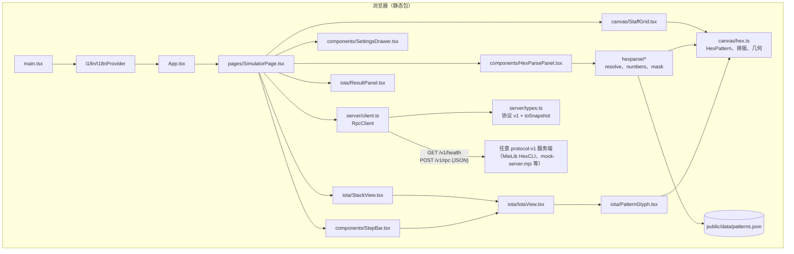

# 架构

[English](./ARCHITECTURE.md) · [README](./README.zh-CN.md) · [协议](./PROTOCOL.zh-CN.md)

## 目标

- **纯前端。** 不打包服务端，不依赖 Minecraft API，构建期也不需要知道 MieLib 的存在。
- **贴合协议而非绑定厂商。** 客户端只依赖 `docs/PROTOCOL.zh-CN.md`（`GET /v1/health`、`POST /v1/rpc`、iota JSON schema）。任何说这套方言的服务端都能用。
- **有状态的东西都在浏览器里。** 服务端地址、token、语言、hexParse 源码与画出的法杖通过 `localStorage` 跨刷新保留。

## 组件图

## 数据流

### 施法

1. **选择来源。** `SimulatorPage` 同时保存 hexParse `code` 和画出的 `patterns` 数组。
   *运行* 模式的开关（`hexParse 源码` / `画出的图案`）决定发送哪一个：
   - 源码模式：文本框内容（为空时回退到画出的法杖）；
   - 图案模式：`patternsToCode(patterns)` 输出形如 `NORTH_EAST_waaw` 的 `DIR_signature` token，所有兼容 hexParse 的服务端都能理解。
2. **请求。** `RpcClient.rpc({ cmd: "run", code })` 向 `${base}/v1/rpc` 发 POST；配置了 token 时带
   `Authorization: Bearer <token>`，并附带用于关联的 `id`。
3. **归一化。** `toSnapshot(response)` 把回复压平成 `CastSnapshot`：按协议优先取 `data.cast.stack`，
   否则取 `data.stack`；缺失的数组补 `[]`，缺失的栈保持 `null`（从而区分「没报栈」和「空栈」）。
   `mergeStack(previous, next)` 在某条命令（`reset`、`ping`、`step.abort` 等）没有返回栈时保留上一份。
4. **渲染。** `StackView` 把底→顶的数组反转，栈顶排在最前并标记。`IotaView` 用 `classifyIota`
   分类并渲染数字、向量、布尔、null、garbage、图案、实体、可折叠列表，或带类型徽章的通用 chip。
   图案 iota 用 `pattern.startDir` + `pattern.angles`；缺失时 `patternFromIota` 解析 `text`
   （`NORTH_EAST waaw` 形式）。

### 绘制

1. `StaffGrid` 把指针位置映射为轴向六边形坐标（`screenToHex`）。
2. 每一笔是一个 `HexPattern`（起点方向 + 角度字母）。`tryAppendDir` 拒绝非法移动（折返到已有线段），
   绘制状态机通过把已有图案裁剪到点击顶点来实现「点击编辑」——规则与 HexTools 的法杖网格一致。
3. 完成的笔画进入 `patterns` 数组：它是画布、图案计数和「画出的图案」模式的唯一数据源。
   撤销/重做是 `SimulatorPage` 里有上限的历史栈。
4. 文本解析到法杖：`parseHex` → `layoutPatterns`（从左到右计算包围盒），再 `fitToPatterns()` 把整体缩放到视野内。

### 单步

`step.begin` 返回 `data.step`（`total`、`index`、`done`，可选 `executed`、`preview`、`stopped`）。
`StepBar` 常驻显示，保证 Begin/Next/Abort 始终可发现；没有活动会话或已完成时 Next 禁用。
每次 `step.next` 的回复仍带完整施法结果，因此栈与结果面板会原地更新。

## 模块职责

| 路径 | 职责 |
|---|---|
| `src/server/types.ts` | 协议 v1 传输类型；`toSnapshot`、`mergeStack` 归一化 |
| `src/server/client.ts` | URL 归一化、fetch 封装、`RpcError` 分类（network、类 CORS、timeout、http-status、bad-json、mixed-content） |
| `src/canvas/hex.ts` | 六边形几何：坐标、方向、`HexPattern`、笔画合法性、法杖排版 |
| `src/canvas/StaffGrid.tsx` | 2D canvas 法杖：指针/双指/滚轮处理、绘制状态机、渲染 |
| `src/hexparse/*` | hexParse 解析器（数字、遮罩、命名图案、特殊记号）与 `patternsToCode` |
| `src/iota/*` | iota 分类/渲染、栈视图、结果面板、SVG 图案 glyph |
| `src/components/*` | 设置抽屉、hexParse 编辑器、单步条、内联图标 |
| `src/i18n/*` | 带类型的文案表（en/zh）、Provider、解析消息翻译 |
| `src/pages/SimulatorPage.tsx` | 状态所有者：设置、连接、法杖历史、RPC 编排 |

## 接入另一个服务端实现

客户端里没有任何服务端特定代码。要让新的后端可用：

1. **传输。** 提供 `GET /v1/health` → `{"ok": true, "protocol": 1, "server": "<名称>", "version": "<版本>"}`，
   无需鉴权。提供 `POST /v1/rpc`，接受 JSON `{ id?, cmd, code?, label?, token? }`，回复
   `{ id?, ok, lines?, data? }`。为应用来源加 CORS 头（并处理 `OPTIONS`）。
2. **鉴权。** 接受 `Authorization: Bearer <token>`（优先）或 body 里的 `token`。客户端配置了 token 时只发请求头，不重复放 body。
3. **命令。** 至少实现 `run`、`stack`、`reset`、`ping`。`step.*`、`complete`、`profile.*`、`env.*`
   都是可选的——UI 会优雅降级：没有 `step.*` 时单步条会把服务端错误显示为横幅。
4. **Iota JSON。** 每个 iota 输出 `type`、`text`、`color`、`rich`；数字/布尔附带 `value`；图案附带
   `pattern: {startDir, angles}`；实体附带 `entity`；列表附带递归 `children`。除迷你 glyph 和结构化
   实体/列表展示外，仅靠 `text` 也能正常显示。
5. **结果。** 施法数据放在 `data.cast`（`resolution`、`steps`、`ops`、`stack`、`ravenmind`、`mishaps`、
   `mediaUsed`、`mediaDust`）；仅查栈的命令放在 `data.stack` / `data.ravenmind`。失败时 `ok: false`
   并在 `data.error` 给出原因。
6. **验证。** `scripts/smoke-rpc.mjs` 使用 `scripts/mock-server.mjs`；把客户端 base URL 换成你的服务端，
   跑同一组命令即可验证行为一致。

前端不依赖 HexCLI 的具体日志行；除 `ok` 外没有任何必填字段，多余的未知字段会被忽略。

## 设计取舍与限制

- 画布刻意不用 WebGL（2D canvas），以保持包体小、兼容软件渲染；图案仍有轻微的呼吸动画。
- `patterns.json`（约 460 KB）是静态资源，每页只加载一次并缓存在内存；只有 hexParse 面板需要它，加载不会阻塞应用外壳。
- 客户端不做自动重试：每次点击就是一次 RPC，错误会明确展示而不是被吞掉。
- token 以明文存放在 `localStorage`。对本地开发工具可以接受，但不要复用生产密钥。
